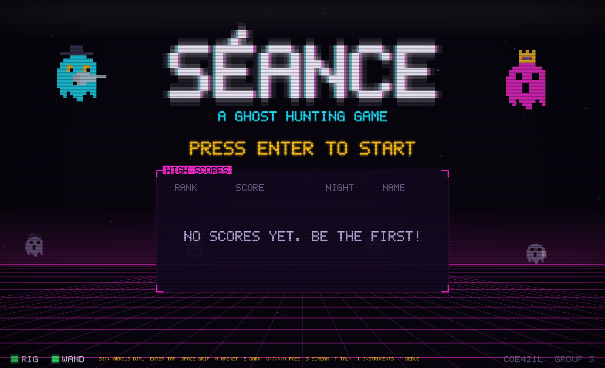
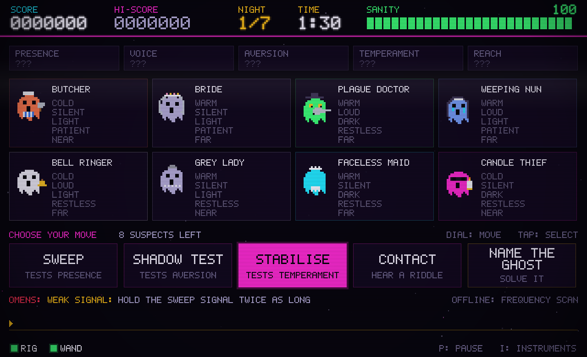
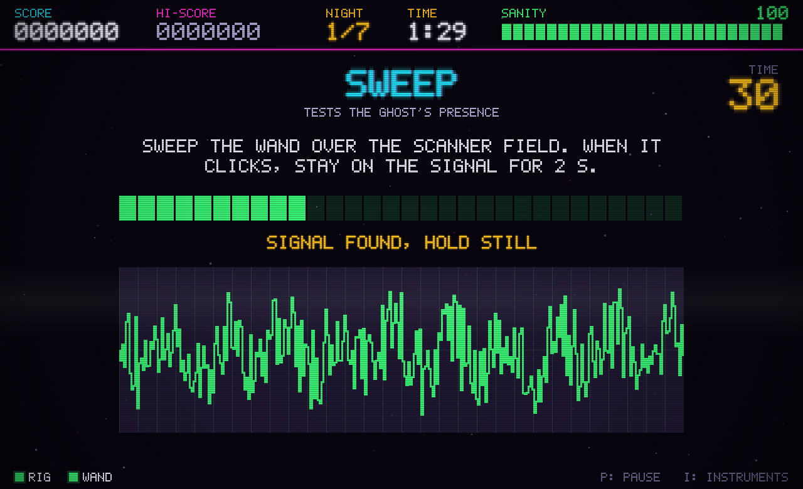
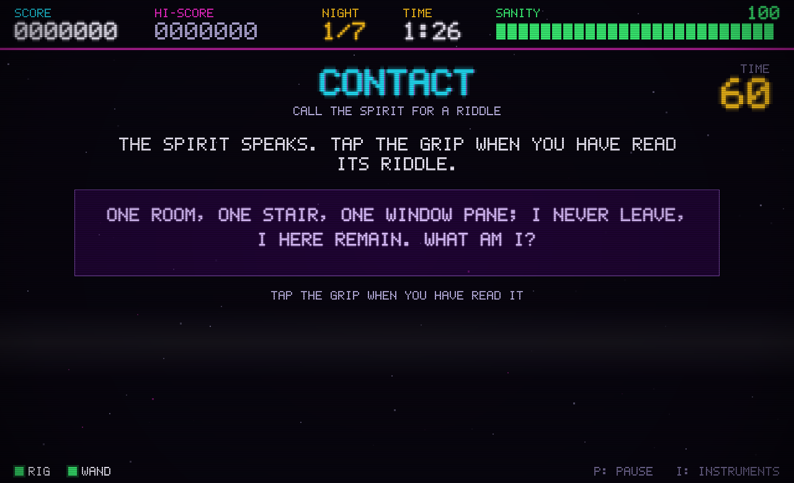
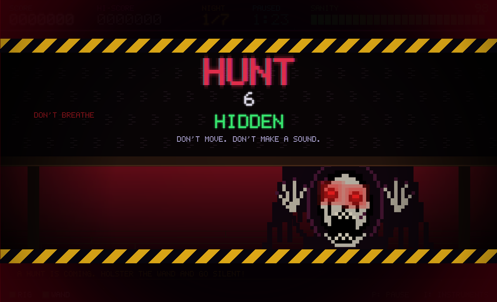
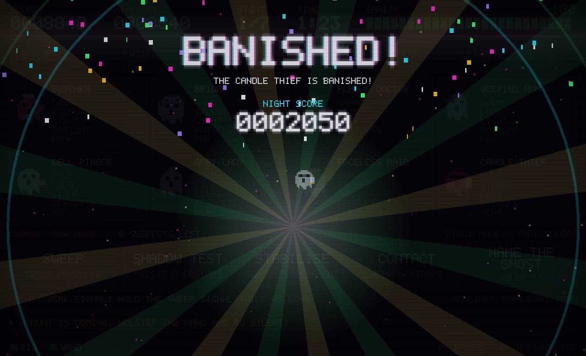
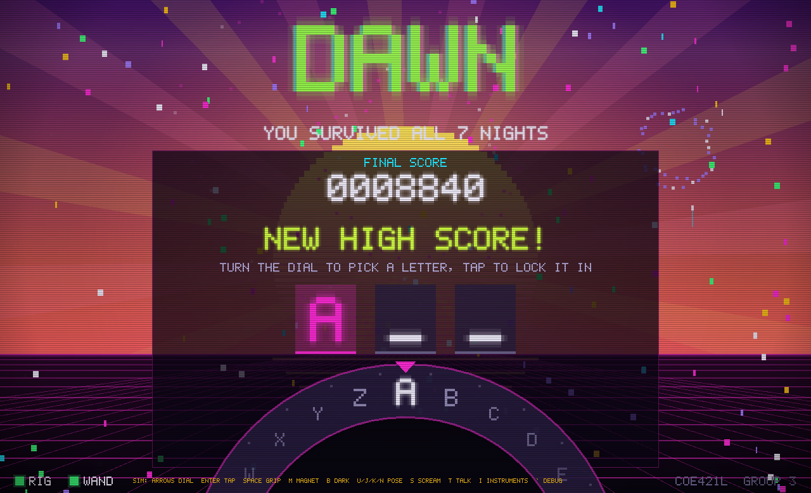

# Seance

An arcade ghost-hunting game played with real hardware: a Java game on the PC, an Arduino Uno "rig" on the table and a LilyPad "wand" in your hand, linked over XBee.

COE421L Final Project, American University of Sharjah, Fall 2026

## Screenshots

| | |
|:---:|:---:|
|  |  |
| **Title screen** with the high score table | **The board:** eight suspects, the five traits and tonight's tests |
|  |  |
| **Sweep:** the wand has found the signal, hold still | **Contact:** the spirit answers with a riddle |
|  |  |
| **Hunt:** wand holstered and silent, the spirit searches under the bed | **Banished:** the night is won |
|  |  |
| **Wrong guess:** the real ghost lunges at you | **Dawn:** all 7 nights survived, enter your initials |

## How to play

- **Survive 7 nights.** Each night one ghost hides among 8 suspects, and you have 1:30 to find it. The timer pauses during hunts and for 3 s after each one.
- **Every ghost has five yes or no traits:** Presence (cold or warm), Voice (loud or silent), Aversion (fears light or dark), Temperament (restless or patient) and Reach (near or far). There are 32 ghosts, one for each combination.
- **Run tests.** Turn the dial to choose a move and tap the wand's grip to select it. Each night three of the four physical tests work, and each one proves one trait:
  - **Sweep** (Presence): the servo hides a magnet under one mark. Sweep the wand over the field. When the rig clicks, hold the wand on the signal for 1 s.
  - **Frequency Scan** (Voice): turn the dial to the ghost's frequency. The clicks speed up as you get close. Hold it there for 2 s.
  - **Shadow Test** (Aversion): the game calls out DARK and LIGHT in a random rhythm. Cover and uncover the wand's light sensor to match.
  - **Stabilise** (Temperament): the wand shakes in long buzzes. Calm taps on the grip, at least half a second apart, slow it down.
- **Contact.** Hold the grip for 3 s to call the spirit. It answers with a riddle about a trait that no test has proven yet. The riddle is always true, but it never says which trait it is about. You work out the trait and cross out suspects yourself.
- **Sanity** starts at 100 and carries across nights. Tests cost sanity (4 for a pass, 8 for a fail, 2 for Contact). A wrong name costs 25, and letting the ghost escape costs 20. At 0 the run is over.
- **Hunts come at random.** When the alarm sounds you have 5 s to holster the wand (tip down) and go silent. Every second you are exposed costs sanity, and being caught in the middle of a test costs 20.
- **Name the ghost**, then **banish it**: for each of its arrows, tap the grip and flick the wand that way. Finish with a loud noise (loud ghost) or 2 s of silence (silent ghost).
- **Score:** each night scores (100 + 8 x sanity) x multiplier x night number. Proving fewer traits with tests before naming gives a higher multiplier. The top five scores are kept in `scores.txt`.
- **Omens** change the rules for a night, for example "Restless Spirits: hunts come sooner" or "Weak Signal: hold the Sweep signal twice as long".
- Survive all 7 nights to reach **dawn**.

## Hardware

**Rig (Arduino Uno, USB serial to the PC at 9600 baud)**

| Part | Pin | Used for |
|---|---|---|
| Potentiometer (frequency dial) | A1 | choosing moves and suspects, the Frequency Scan, high score initials |
| Sound detector (ENVELOPE output) | A0 | silence during hunts, the banishing finish |
| Servo (pointer over the scanner field) | 9 | hides the Sweep signal under one of 7 marks (0 to 180 degrees) |
| RGB LED (common anode, + to 5V) | R 6, G 3, B 5 | sanity colour and alerts |
| Buzzer module (sounds when LOW) | 8 | Sweep clicks, hunt alarm, beeps |

**Wand (LilyPad Arduino, XBee ZigBee to an XBee Explorer on the PC at 9600 baud)**

| Part | Pin | Used for |
|---|---|---|
| Hall effect sensor | A0 | finding the magnet in the Sweep |
| Touch sensor (grip) | 2 | taps and holds to select, Contact, Stabilise |
| Light sensor | A4 | the Shadow Test |
| Accelerometer | X A3, Y A2, Z A1 | poses (LEVEL, UP, DOWN, LEFT, RIGHT): holstering, banishing |
| Vibration motor (Vibe Board) | 3 | heartbeat during tests, Stabilise shaking, alerts |
| XBee | TX to pin 10, RX to pin 11 | radio link to the PC |

## Getting started

### 1. Arduino

1. **Rig (Uno):** open `arduino/Seance_Rig/Seance_Rig.ino`, choose the board **Arduino Uno** and upload.
   Open the Serial Monitor at 9600 baud. You should see `R,...` lines ten times a second.
   Type `SERVO,150`, `LED,255,0,0` and `ALARM,3` to check the commands. **Close the Serial Monitor afterwards**, or Java cannot open the port.
2. **Wand (LilyPad):** open `arduino/Seance_Wand/Seance_Wand.ino`, choose the board **LilyPad Arduino** (ATmega328P) and upload through the FTDI adapter. Unplug the battery while the FTDI is connected.
   To watch its lines over the FTDI, set `#define DEBUG 1`, upload, then set it back to 0.
3. **XBee check:** plug the coordinator XBee into the Explorer on the PC, power the wand, and open the Explorer's port in the Serial Monitor at 9600 baud. You should see `W,...` lines. Typing `VIB,150,100,5` should make the wand pulse. The XBees use the same settings as Lab 8. Close the Serial Monitor afterwards.

The other sketches in `arduino/` are standalone checks:

| Sketch | Board | What it checks |
|---|---|---|
| `Rig_LED_Servo_Test` | Uno | each LED colour and the servo angles, with typed commands |
| `Wand_XBee_Check` | LilyPad | talks to the wand's own XBee in command mode (+++) to check the wiring and network join |
| `Wand_Radio_Test` | LilyPad | sends test lines on both XBee pins, to find which wire is which |

### 2. Eclipse setup

The game uses the jSSC serial library from Lab 9 (`lib/jssc-2.9.6.jar`, already in the repository) and the lab's `SerialPortHandle` approach. As in the lab, use JavaSE-20 or below as the execution environment.

- **Import:** File > Import > General > Existing Projects into Workspace, then choose this folder. The `.project` and `.classpath` files already put `src` and `lib/jssc-2.9.6.jar` on the build path.
- **Or create it by hand:** File > New > Java Project, untick "Use default location" and choose this folder, untick "Create module-info.java", then Finish. Right-click `lib/jssc-2.9.6.jar` > Build Path > Add to Build Path.

The main class is `seance.Game` (`src/seance/Game.java`). Run it as a Java Application. Program arguments go in Run > Run Configurations > Arguments.

### 3. Find the ports

Run `Game` with the single argument `list` to print the serial ports.

- The Uno usually shows as `/dev/cu.usbmodem...` on macOS or `COM3` on Windows.
- The XBee Explorer usually shows as `/dev/cu.usbserial-...` on macOS or `COM4` on Windows.

### 4. Run

| Program arguments | What runs |
|---|---|
| (none) | keyboard simulator: play with no hardware at all |
| `/dev/cu.usbmodem1101 /dev/cu.usbserial-A601EPOW` | both boards (rig port first, wand port second) |
| `/dev/cu.usbmodem1101 sim` | real rig, wand played on the keyboard |
| `sim /dev/cu.usbserial-XXXX` | rig played on the keyboard, real wand |
| `debug` (anywhere in the list) | starts with debug mode on |

With the hardware connected, the RIG and WAND dots in the bottom left turn green.

**Without Eclipse:** from this folder, compile and run with

```
javac -encoding UTF-8 -cp lib/jssc-2.9.6.jar -d bin src/seance/*.java
java -cp "bin:lib/jssc-2.9.6.jar" seance.Game
```

(on Windows use `;` instead of `:` in the class path) and add the same arguments to the end of the `java` line.

**Optional music:** the game composes its own 8-bit music in code. To use your own, make an `audio/` folder next to `src/` and add `eerie.wav`, `tense.wav`, `heavy.wav` and `title.wav`.

## Controls

### Keyboard simulator

| Key | Does |
|---|---|
| Left / Right | turn the dial (one choice per press on menus) |
| Space | hold the grip (press = tap, hold = hold) |
| Enter | tap (simulator only; with the real wand, only the touch grip confirms) |
| M | magnet under the wand tip |
| B | cover the light sensor |
| U / J / K | point the wand UP / LEFT / RIGHT |
| N | point DOWN (holster) |
| S / T | scream / talk |
| I | show or hide the live instruments |
| L | re-level the wand (hold it level, tip forward). This also happens during every night's intro. |
| Esc | quit |

### Pause

**P** pauses and resumes a night. While paused the hub sends no readings, so every timer stops: the night timer, the test, the hunt and the banishing all carry on from the same moment. The music, the rig's buzzer and the wand's motor stop and come back on resume.

### Debug mode

Press the backquote key (`` ` ``) or F1, or start the game with the argument `debug`. Pressing it again hides the debug panel (the keys still work), and a third time turns debug mode off. In debug mode Enter always counts as a tap.

**Title screen**

| Key | Does |
|---|---|
| 1 to 7 | start a run on that night |
| Enter | start on night 1 |

**During a night**

| Key | Does |
|---|---|
| 1 to 5 | start Sweep, Frequency Scan, Shadow Test, Stabilise or Contact |
| 6 | start a hunt now, or end the current one |
| 7 | pass the test (Contact: the spirit speaks, then closes), skip the intro, or the next banishing step |
| 8 | fail the running test |
| 9 / 0 | add 30 s to the night timer / set it to 10 s |
| - / = | lose / gain 10 sanity |
| [ | go straight to naming the ghost |
| ] | the ghost is named correctly: go straight to the banishing |
| , | win the night at once |
| . | reach dawn |
| / | lose all sanity (game over) |
| ; | tonight's omen becomes the next one on the list |
| ' | roll a new random set of omens |
| E | the timer runs out, so the ghost escapes |
| D | print the night's state to the console |
| Y | start a new night |

**End screen:** `.` plays the dawn again.

**Dev tools (any screen)**

| Key | Does |
|---|---|
| G | god mode: sanity never drops |
| H | hunts on / off (6 still starts one) |
| F | freeze the night timer |
| Z / X | game speed slower / faster (x0.25 to x4) |
| C | serial monitor panel: the latest line from each board and the commands sent |
| R | rig test: every LED colour, the servo through all 7 marks, the buzzer |
| W | wand buzz (L re-levels it) |

## Tuning

All the numbers are in `src/seance/Config.java`. Set the sensor thresholds from your own test values.

| Setting | Default | Meaning |
|---|---|---|
| `SILENT_LEVEL` | 180 | sound detector reading that still counts as silence (a quiet room reads around 120) |
| `HUNT_NOISE_LEVEL` | 200 | during a hunt, only sound above this gives you away |
| `SCREAM_LEVEL` | 400 | a loud finish for the banishing (a loud snap, clap or shout right at the mic) |
| `NIGHT_TIME_MS` | 90000 (1:30) | each night's timer. It runs on the board, in tests, while naming and during the banishing. It pauses during hunts and for `HUNT_GRACE_MS` (3 s) after. At 0 the ghost escapes (`ESCAPE_COST` 20 sanity). |
| `HUNT_GAP_MIN` / `MAX` | 45 to 65 s | time between hunts (28 to 38 s below 25 sanity) |
| `HUNT_WARNING_MS` / `HUNT_ACTIVE_MS` | 5 s / 6 s | time to hide, then how long to stay hidden |
| `WORKING_TESTS` | 3 | physical tests that work each night, plus Contact |
| `TEST_BEAT_MS` | 1300 | wand heartbeat speed during tests (none during Contact or the banishing) |
| `DARK_RATIO` | 0.35 | how dark counts as covered (below 35% of the room light) |
| `DIAL_TOLERANCE` | 40 | how close the dial must be in the Frequency Scan |
| `SERVO_SPEED` | 12 | servo speed in ms per degree (lower is faster) |
| `PASS_COST`, `FAIL_COST`, `CONTACT_COST`, `WRONG_NAME_COST`, `EXPOSURE_COST` | 4, 8, 2, 25, 2 | sanity costs |

In the wand sketch, change `TILT_THRESHOLD` (60) if poses flicker or need too much tilt.

## Architecture

### Observer pattern

The Java code follows the **Observer** pattern exactly as it was taught in class (lecture 08, Observer Design Pattern): the same four classes, the same names and the same steps.

| On the slides | In Seance |
|---|---|
| `interface Subject` with `registerObserver`, `removeObserver`, `notifyObservers` | `Subject` (the same three methods) |
| `interface Observer` with `update(Date d)` | `Observer` with `update(Reading r)` |
| `class ConcreteSubject implements Subject`, an `ArrayList<Observer>` and a `for` loop calling `update` | `ConcreteSubject` (the same list and loop) |
| `class ConcreteObserver implements Observer`: keeps the `Subject` and calls `subject.registerObserver(this)` in its constructor | `ConcreteObserver` (the same constructor) |
| `class Clock extends ConcreteSubject implements Runnable`: its constructor starts a thread, `run()` notifies then sleeps | `SensorHub extends ConcreteSubject implements Runnable`: notifies every 50 ms |
| `Mouse` and `Alice extend ConcreteObserver`, call `super(subject)` and override `update` | every Observer below |
| `Main`: `Clock c1 = new Clock(); Mouse m1 = new Mouse(c1); ...` | `Game.launch()`: `new SensorHub(...)`, then `new Wand(hub, ...)`, `new Game(...)`, `new Display(hub, ...)` ... |

`SensorHub` is the Subject. It reads both boards, and 20 times a second it packs the latest rig and wand values into one `Reading` and calls `notifyObservers()`. That calls `update(Reading r)` on every Observer, the same way the clock passes the `Date` to every mouse. Each tick runs on the Swing thread (`invokeAndWait`), so the game and the screen are only ever changed by one thread.

```
 Rig (Uno) --USB--> SerialLink --+
                                 +--> SensorHub (Subject) --Reading, 20x a second--> every Observer
 Wand (LilyPad) --XBee--> SerialLink --+
```

**Observers** (each extends `ConcreteObserver` and looks only at the part of the reading it needs):

| Observer | Registered | Reads |
|---|---|---|
| `Wand` | whole game | the time, to re-send lost commands |
| `Game` | whole game | grip taps (title, end screen), run over |
| `Display` | whole game | every sensor (instruments panel, connection lights), then redraws |
| `SoundEffects` | whole game | the game's state each tick, to play a sound when something changes |
| `Night` | while that night runs | the dial (menu, suspects), grip taps |
| `Sweep` | while the test runs | Hall sensor |
| `FrequencyScan` | while the test runs | dial |
| `ShadowTest` | while the test runs | light sensor |
| `Stabilise` | while the test runs | grip taps |
| `Contact` | while the test runs | dial, grip |
| `Hunt` | while the hunt lasts | pose and sound |
| `Banishing` | until the ghost is banished | grip taps, pose and sound |

Observers join and leave while the game runs, as in the slides. Making a Night, a test, a hunt or the banishing registers it (the `ConcreteObserver` constructor), and each one removes itself with `subject.removeObserver(this)` when it is done. The Night never has to feed them data; it only reads their results. A new `Test` object is made every time the player starts a test.

### How the boards talk

Both boards send one status line ten times a second and take one-line commands back. Neither board holds any game state: every decision is made by the Java program.

| From | Line | Meaning |
|---|---|---|
| Rig | `R,dial,soundPeak,servoAngle,moving` | dial 0-1023, loudest sound since the last line |
| Wand | `W,hall,touch,taps,light,pose,still` | taps is a running count, so quick taps are never missed |

- **Rig commands:** `SERVO,a` `SPEED,ms` `LED,r,g,b` `CLICKS,gap` `ALARM,n` `BEEP,ms` `STOP` `PING`
- **Wand commands:** `VIB,on,off,count` `VIB,0` `BUZZ,ms` `BEAT,periodMs` (lub-dub heartbeat, `BEAT,0` stops) `IDLE` `CAL` `PING`
- `IDLE` means nothing should vibrate. It is re-sent every second while the wand is quiet, so a lost stop is fixed within a second. During the banishing the PC sends `VIB,0` every second instead and ignores any vibration request.
- An identical repeat of a repeating command is ignored, so the PC's once-a-second re-send keeps the rhythm steady.

### Classes

| Class | Role |
|---|---|
| `Subject`, `Observer` (interfaces) | the Observer pattern contract, as in the slides |
| `ConcreteSubject`, `ConcreteObserver` | the slides' two base classes: the list of Observers with its loop, and self-registration |
| `SensorHub` | the Subject (like the slides' Clock): latest sensor values, sends a `Reading` to every Observer 20 times a second; also game time, pause and debug speed |
| `Reading` | one snapshot of every sensor, passed to `update()` |
| `Game` | main class: title, run end, high score initials, pause and debug keys (Observer) |
| `Run` | night number, score and sanity across the run |
| `Night` | one night: 3 working tests + Contact, 8 suspects picked so those tests always leave exactly one, omens, the 1:30 timer, the menu and naming (Observer) |
| `Ghost` | name, five traits and banishing sequence (32 ghosts) |
| `Traits` | trait names and values |
| `Riddles` | the spirit's 80 riddles, eight for every value of every trait |
| `Test` | abstract superclass of the five tests: time limit, result, joins and leaves the hub (Observer) |
| `Sweep`, `FrequencyScan`, `ShadowTest`, `Stabilise`, `Contact` | the five tests, each extends `Test` |
| `Hunt` | warning, exposure checks and sanity loss (Observer) |
| `Banishing` | tap and flick for each arrow, then a scream or silence; keeps the wand motor off so the accelerometer reads cleanly (Observer) |
| `Display` | the arcade-style screens, drawn on an inner `JPanel` (its parent class is `ConcreteObserver`); I shows the live instruments (Observer) |
| `PixelFont` | a 5 x 7 pixel font drawn in code, so no font files are needed |
| `GhostSprites` | pixel art for the ghosts: one shared body plus each ghost's own accessory |
| `SerialPortHandle` | opens one port with jSSC and reads and writes lines, as in Lab 9 |
| `Link` (interface), `SerialLink`, `ConsoleLink` | a reader thread per board that feeds the hub, or the simulator's stand-in |
| `Rig`, `Wand` | send commands to each board (`Wand` is also an Observer) |
| `Hardware` | the hub, rig, wand and audio passed around as one object |
| `AudioDirector` | 8-bit music composed in code: title theme, then calm, tense or panic by sanity; cut during hunts |
| `Synth` | a small 8-bit synthesiser (square, triangle, sine, noise) that makes all the sounds |
| `SoundEffects` | PC sound effects where the rig buzzer and wand stay quiet: menus, night start, Contact, banished, hunt start and end (Observer) |
| `Leaderboard` | top five scores in `scores.txt` |
| `Simulator` | keyboard stand-in for the hardware |
| `Config` | every tuning number in one place |

### Troubleshooting

- **"Could not open port":** close the Arduino Serial Monitor, and check the port names with `list`.
- **Rig dot red:** wrong port, or the rig sketch is not uploaded.
- **Wand dot red:** the wand is off, the battery is flat, or the XBees are not paired (test as in Arduino step 3).
- **Uno resets when the servo moves:** the servo needs its own 5 V supply (with GND joined).
- **Poses wrong:** hold the wand level when it powers on (it calibrates then). Flip `>` / `<` in `currentPose()` in the wand sketch if up and down or left and right are swapped.

## Project structure

```
Seance/
  src/seance/                   the game (36 Java classes, package seance)
  arduino/
    Seance_Rig/                 Uno: dial, sound detector, servo, RGB LED, buzzer (USB to the PC)
    Seance_Wand/                LilyPad: Hall, touch, light, accelerometer, vibration (XBee)
    Rig_LED_Servo_Test/         standalone LED and servo check
    Wand_XBee_Check/            standalone check of the wand's XBee wiring
    Wand_Radio_Test/            standalone two-way radio test
  lib/jssc-2.9.6.jar            jSSC serial library (from Lab 9)
  docs/images/                  screenshots
  .project, .classpath          Eclipse project files
```

## Demo video

Demo video: (link to be added)

## Team

| Name | Student ID |
|---|---|
| Hisham Mohammed | B00098749 |
| Mazen Maharoof | B00098245 |
| Raghav Arya | B00101969 |
| Ryhan Nijam | B00100719 |
| Sameer Ahmed | B00099777 |

Instructor: Mr. Ali Reza Sajun

Group 3, COE421L, American University of Sharjah
